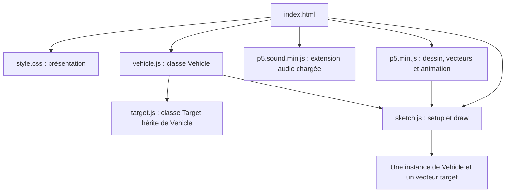
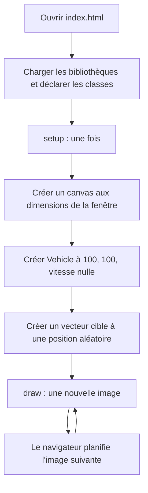
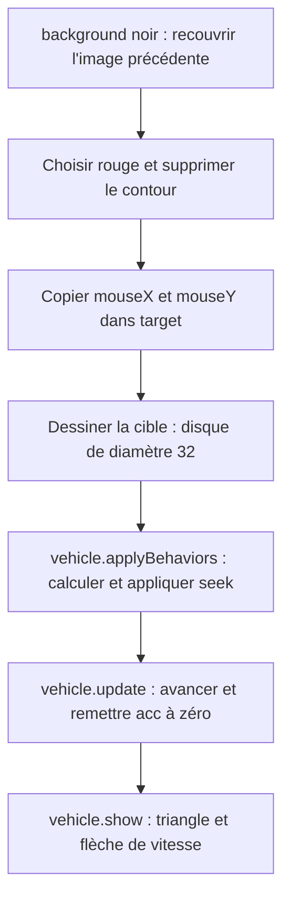
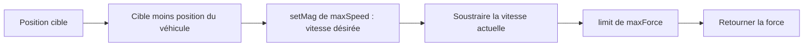
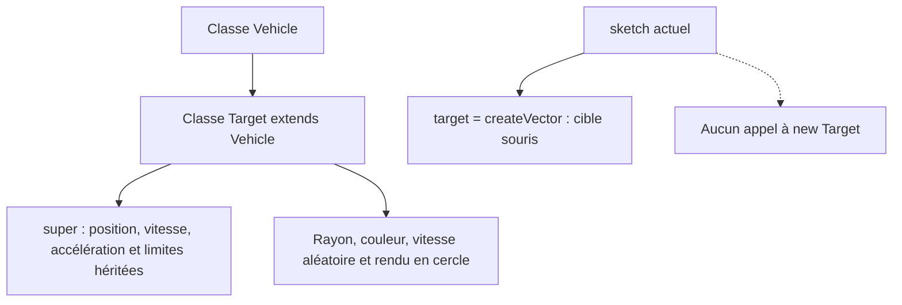

# Comprendre l'exemple `1-Seek`

Analyse du dossier `1-Seek` du projet **SteeringBehavioursM2IA2_2026_2027_G2**, rédigée le 12 octobre 2026 à partir du code présent. Ce document explique le programme sans le modifier. Les schémas Mermaid sont visibles dans les lecteurs Markdown compatibles, notamment GitHub.

## 1. Ce que fait réellement le programme

Le navigateur affiche un fond noir, un triangle bleu et un disque rouge. Le disque suit la souris. Le triangle essaie de se diriger vers lui en changeant progressivement sa vitesse. Une flèche rouge représente la vitesse du triangle.

Le comportement utilisé s'appelle **seek**, c'est-à-dire « chercher à rejoindre une position ». Le triangle ne saute pas directement sur la souris : il reçoit une petite correction de vitesse à chaque image.

Dans cette version :

- il existe **un seul véhicule**, créé à la position `(100, 100)` ;
- la cible utilisée est un **vecteur de position**, pas une instance de la classe `Target` ;
- le véhicule ne freine pas spécialement à proximité de la cible ;
- aucune collision, réapparition aléatoire ou interface de réglage n'est programmée ;
- la méthode de rebouclage `edges()` existe, mais elle n'est pas appelée ;
- aucun son n'est joué par le code de l'exercice.

Cette distinction entre « le code existe » et « le code est appelé » aide à comprendre ce que l'on doit effectivement voir à l'écran.

## 2. À quoi servent HTML, CSS, JavaScript et p5.js ?

| Élément | Rôle dans cet exemple |
|---|---|
| HTML | Charge les fichiers et constitue la page du navigateur. |
| CSS | Gère la présentation de la page, notamment les marges. |
| JavaScript | Décrit les objets, les calculs et les actions à exécuter. |
| p5.js | Fournit le canvas, les fonctions de dessin, les vecteurs et la boucle d'animation. |

Le **canvas** est une surface de dessin dans la page. Ici, il est créé par JavaScript : il n'est donc pas nécessaire d'écrire une balise `<canvas>` dans le HTML.

Un **sketch** est un petit programme p5.js. Celui-ci fonctionne en **mode global** : des noms comme `createCanvas`, `mouseX` ou `width` sont directement accessibles, sans préfixe d'instance p5.

### Le repère du canvas

```text
(0, 0) ------------------------> x augmente vers la droite
  |
  |      position (100, 100)
  |              ●
  |
  v
y augmente vers le bas
```

Les coordonnées sont exprimées en pixels du repère de dessin. Une vitesse `(2, -1)` signifie ici « avancer de 2 pixels vers la droite et de 1 pixel vers le haut à chaque mise à jour ».

## 3. Organisation du dossier : tous les fichiers

| Fichier | Contenu et rôle | Utilisé par la page ? |
|---|---|---|
| [index.html](index.html) | Point d'entrée ; charge le CSS, p5.js et les scripts de l'exemple. | Oui |
| [sketch.js](sketch.js) | Déclare `setup()` et `draw()`, crée le véhicule et relie la cible à la souris. | Oui |
| [vehicle.js](vehicle.js) | Classe `Vehicle` : état du véhicule, `seek`, application des forces, déplacement et dessin. | Oui |
| [target.js](target.js) | Classe `Target extends Vehicle`, prévue pour une cible qui bouge de façon autonome. | Fichier chargé, classe non instanciée |
| [style.css](style.css) | Supprime marges et espaces autour de la page ; rend le canvas comme un bloc. | Oui |
| [jsconfig.json](jsconfig.json) | Configuration destinée à l'éditeur de code : JavaScript ES6 et informations de types p5. | Non, pas exécuté par le navigateur |
| [test.js](test.js) | Un seul commentaire demandant des fonctions de collision. Aucun test exécutable. | Non, pas chargé |
| [libraries/p5.min.js](libraries/p5.min.js) | Bibliothèque p5.js embarquée, version **1.7.0** d'après son en-tête. | Oui |
| [libraries/p5.sound.min.js](libraries/p5.sound.min.js) | Extension audio p5.sound, version **1.0.1** d'après son en-tête. | Chargée, aucune fonctionnalité audio utilisée par l'exercice |

Le suffixe `.min.js` indique une bibliothèque **minifiée** : son texte est compacté pour la distribution. Ce n'est pas le fichier à lire ou modifier pour apprendre le fonctionnement de cet exercice.

### Comment les fichiers s'articulent



Les flèches décrivent le chargement ou l'utilisation. `target.js` dépend de `vehicle.js` parce qu'on ne peut pas déclarer `class Target extends Vehicle` avant que `Vehicle` soit connue.

Les scripts classiques sont chargés dans cet ordre : p5, p5.sound, `vehicle.js`, `target.js`, `sketch.js`. Déclarer une classe rend sa définition disponible ; cela ne crée pas automatiquement un objet.

## 4. Le cycle de vie p5.js : `setup()` puis `draw()`

`setup()` est appelé une fois au démarrage. `draw()` est ensuite rappelé régulièrement pour produire les images de l'animation. Par défaut p5 essaie de dessiner 60 images par seconde, mais la cadence réelle dépend du navigateur et de la machine. Voir les références officielles de [setup()](https://p5js.org/reference/p5/setup/) et [draw()](https://p5js.org/reference/p5/draw/).



### Ce que fait `setup()` ici

1. `createCanvas(windowWidth, windowHeight)` crée une surface de la taille de la fenêtre au démarrage.
2. `new Vehicle(100, 100)` fabrique le véhicule.
3. `createVector(random(width), random(height))` crée une position de cible aléatoire dans le canvas.

La position aléatoire de la cible est remplacée par les coordonnées de la souris dès le premier passage dans `draw()`. Elle ne constitue donc pas une cible autonome.

### Ce que fait chaque passage dans `draw()`



Le canvas n'est **pas effacé automatiquement** avant chaque `draw()`, contrairement à un commentaire du fichier : c'est `background("black")` qui recouvre l'image précédente. Sans cette opération, les anciens dessins resteraient visibles et formeraient des traces.

De même, `circle(target.x, target.y, 32)` dessine un cercle de **diamètre 32**, donc de rayon 16 ; le commentaire qui parle de rayon 32 est imprécis. C'est le troisième argument de [circle()](https://p5js.org/reference/p5/circle/) qui donne le diamètre dans la configuration utilisée.

## 5. Classe, objet, méthode et `this` : quelques repères

Une **classe** est un modèle d'objet. `Vehicle` décrit ce que possède un véhicule et ce qu'il peut faire. Une **instance** est un objet concret fabriqué à partir de ce modèle : `new Vehicle(100, 100)` en crée une.

Le **constructeur** est exécuté lors de cette création. Ses arguments `x` et `y` deviennent la position initiale du véhicule. Une **méthode** est une fonction associée à l'objet, par exemple `update()` ou `show()`.

Dans une méthode, `this` désigne l'objet sur lequel elle est appelée : `this.vel` signifie « la vitesse de ce véhicule ». C'est ce qui permettrait à plusieurs véhicules d'avoir chacun leur propre position et leur propre vitesse tout en utilisant le même code.

| Propriété de `Vehicle` | Valeur initiale | Signification |
|---|---|---|
| `pos` | `(x, y)`, ici `(100, 100)` | Où se trouve le centre du véhicule. |
| `vel` | `(0, 0)` | Son déplacement par mise à jour, avec direction et amplitude. |
| `acc` | `(0, 0)` | La correction de vitesse accumulée pour la mise à jour en cours. |
| `maxSpeed` | `4` | Longueur maximale du vecteur vitesse : 4 pixels par mise à jour. |
| `maxForce` | `0.1` | Longueur maximale de la force retournée par `seek()`. |
| `r` | `16` | Paramètre de taille utilisé pour le triangle et les bords. |

La force est assimilée ici à une accélération : le code ne modélise pas explicitement une masse différente de 1. La taille `r` n'est pas utilisée par un moteur de collisions, car il n'y en a pas dans cet exemple.

## 6. Comprendre les vecteurs sans prérequis mathématique

Un vecteur 2D peut se représenter par une flèche : il possède une direction et une longueur. p5.js le représente avec deux composantes, `x` et `y`. Selon son rôle, le même type d'objet peut décrire une position, une vitesse ou une force.

Exemple :

```text
Position du véhicule : (100, 100)
Position de la cible : (200, 100)
Cible - véhicule    : (100,   0)
```

La cible est à droite du véhicule. Le vecteur `(100, 0)` pointe donc vers la droite. Si elle était à gauche, sa composante X serait négative.

| Opération rencontrée | Sens dans le programme |
|---|---|
| `createVector(x, y)` | Créer un vecteur. |
| `p5.Vector.sub(a, b)` | Créer le vecteur `a - b`, sans modifier `a` et `b` dans cet usage. |
| `v.setMag(4)` | Donner une longueur de 4 à un vecteur non nul, en conservant sa direction. |
| `v.limit(4)` | Réduire sa longueur si elle dépasse 4 ; conserver les longueurs plus petites. |
| `v.add(other)` | Ajouter `other` à `v`, en modifiant `v`. |
| `v.set(0, 0)` | Remettre les composantes à zéro. |
| `v.heading()` | Obtenir l'angle de la flèche, utile pour orienter le dessin. |

La différence entre `setMag()` et `limit()` est importante : sur un vecteur de longueur 2, `setMag(4)` augmente la longueur à 4, tandis que `limit(4)` laisse la longueur à 2. Un vecteur nul n'a pas de direction ; `setMag()` ne lui invente pas une direction.

Pour approfondir : [documentation officielle de p5.Vector](https://p5js.org/reference/p5/p5.Vector/).

## 7. Comment `seek()` choisit la force

Le véhicule compare **la vitesse qu'il voudrait avoir** avec **celle qu'il a déjà**. La différence fournit une correction :

```text
force de steering = vitesse désirée - vitesse actuelle
```

La vitesse désirée pointe vers la cible et sa longueur vaut `maxSpeed` lorsque la direction vers la cible n'est pas nulle. Le code limite ensuite la correction à `maxForce` pour éviter de changer de vitesse brutalement.



Les quatre étapes correspondent aux lignes principales de `seek()` :

```js
let desiredSpeed = p5.Vector.sub(target, this.pos);
desiredSpeed.setMag(this.maxSpeed);
let force = p5.Vector.sub(desiredSpeed, this.vel);
force.limit(this.maxForce);
return force;
```

`desiredSpeed` est un vecteur complet de vitesse désirée, malgré son nom qui pourrait faire penser à un simple nombre.

### Pourquoi soustraire la vitesse actuelle ?

Si le véhicule va déjà à la bonne vitesse dans la bonne direction, il n'a presque rien à corriger. S'il va vers le bas alors que la cible est à droite, il doit à la fois réduire sa composante vers le bas et augmenter celle vers la droite.

Le steering tient donc compte du mouvement existant. Ce n'est ni une téléportation vers la cible ni une rotation instantanée du triangle.

### Un calcul complet sur deux images

Supposons une cible immobile en `(200, 100)` et un véhicule initialement en `(100, 100)`. Les valeurs sont celles de la classe : `maxSpeed = 4`, `maxForce = 0.1`.

| Étape | Première image | Deuxième image |
|---|---|---|
| Position avant calcul | `(100, 100)` | `(100.1, 100)` |
| Vitesse avant calcul | `(0, 0)` | `(0.1, 0)` |
| Vitesse désirée | `(4, 0)` | `(4, 0)` |
| Correction avant limitation | `(4, 0)` | `(3.9, 0)` |
| Force limitée | `(0.1, 0)` | `(0.1, 0)` |
| Vitesse après mise à jour | `(0.1, 0)` | `(0.2, 0)` |
| Position après mise à jour | `(100.1, 100)` | `(100.3, 100)` |

Le véhicule commence lentement puis accélère. `maxSpeed = 4` est un plafond, pas une vitesse appliquée immédiatement dès la première image.

## 8. De la force au mouvement : trois méthodes différentes

`applyBehaviors(target)` appelle `seek(target)` puis transmet la force obtenue à `applyForce(force)`.

`applyForce(force)` ajoute la force à `acc`. **Elle ne déplace pas encore le véhicule.** L'addition permettrait de cumuler plusieurs influences, mais cette démonstration n'en utilise qu'une.

`update()` effectue ensuite la locomotion :

```text
1. vitesse = vitesse + accélération
2. limiter la longueur de la vitesse à maxSpeed
3. position = position + vitesse
4. accélération = (0, 0)
```

La vitesse persiste d'une image à l'autre. L'accélération est remise à zéro pour que les forces soient recalculées à la prochaine image, sans accumuler indéfiniment celles du passé.

```mermaid
sequenceDiagram
    participant S as sketch.draw
    participant V as Vehicle
    S->>V: applyBehaviors(target)
    V->>V: seek(target) retourne une force
    V->>V: applyForce(force) ajoute à acc
    S->>V: update()
    V->>V: vel += acc ; limiter vel
    V->>V: pos += vel ; acc = 0
    S->>V: show()
    V->>V: dessiner triangle et vecteur vitesse
```

Les unités sont **par image** dans ce code, sans utilisation de `deltaTime`. À exactement 60 mises à jour par seconde, 4 pixels par image correspondent à 240 pixels par seconde ; à une autre cadence, la vitesse apparente par seconde change. Ce modèle simple est adapté à la lecture pédagogique, mais il faut garder cette limite en tête.

## 9. Comment le véhicule est dessiné

`show()` utilise le mouvement déjà calculé ; elle ne déplace pas le véhicule.

1. `push()` sauvegarde l'état de dessin.
2. `stroke("white")` et `fill("blue")` choisissent le contour et le remplissage.
3. `translate(this.pos.x, this.pos.y)` place l'origine du dessin au centre du véhicule.
4. `rotate(this.vel.heading())` oriente le repère dans la direction de sa vitesse.
5. `triangle(...)` dessine le véhicule autour de cette origine locale.
6. `pop()` restaure le repère et les styles précédents.
7. `drawVelocityVector()` ajoute la flèche rouge.

Avec `r = 16`, les sommets du triangle sont `(-16, -8)`, `(-16, 8)` et `(16, 0)` dans son repère local. La pointe est donc orientée vers la droite avant rotation.

La flèche rouge se termine à `pos + vel * 10`. Elle est agrandie dix fois pour être visible : ce facteur ne change **pas** la vitesse réelle. À vitesse maximale, sa ligne mesure 40 pixels.

`push()` et `pop()` évitent que la rotation du véhicule ne fasse tourner aussi le reste de la scène. La cible étant dessinée avant le véhicule, le triangle et sa flèche peuvent visuellement passer par-dessus elle.

## 10. La classe `Target` : prévue, mais inactive

Le mot `target` dans `sketch.js` est un nom de variable. `Target`, avec une majuscule, est un nom de classe. JavaScript distingue les majuscules : ce ne sont pas la même chose.



Si une instance de `Target` était créée :

- son constructeur appellerait celui de `Vehicle` avec `super(x, y)` ;
- elle aurait initialement un rayon de 50, une couleur rouge et une vitesse de direction aléatoire ;
- un timer changerait vitesse, rayon, couleur et accélération environ toutes les **1 000 ms**, donc une seconde ; le commentaire « 500 ms » ne correspond pas au délai écrit ;
- son `update()` modifierait légèrement l'angle de sa vitesse puis appellerait `super.update()` pour avancer ;
- son `show()` dessinerait un cercle au lieu du triangle.

Deux limites sont utiles à connaître pour une évolution :

1. Le constructeur tire une vitesse entre 1 et 6, mais `maxSpeed` reste hérité à 4 : `super.update()` ramènerait donc à 4 une vitesse supérieure.
2. Le timer n'est pas conservé dans une propriété et il n'existe pas de méthode de nettoyage. Plusieurs créations impliqueraient plusieurs timers à gérer.

Ces effets ne se produisent pas dans le programme actuel : le constructeur `Target` n'est jamais exécuté. Charger son fichier ne démarre pas son timer.

## 11. Méthodes disponibles mais non utilisées

### `edges()` : réapparaître au bord opposé

Cette méthode réalise un rebouclage, sans rebond : elle replace le véhicule de l'autre côté et conserve sa vitesse.

| Condition | Repositionnement |
|---|---|
| `pos.x > width + r` | `pos.x = -r` |
| `pos.x < -r` | `pos.x = width + r` |
| `pos.y > height + r` | `pos.y = -r` |
| `pos.y < -r` | `pos.y = height + r` |

La marge `r` permet de sortir au-delà du bord avant de réapparaître. Les comparaisons sont strictes : une égalité au seuil ne déclenche pas le repositionnement. Les deux axes peuvent être traités pendant le même appel.

Mais `draw()` n'appelle pas `vehicle.edges()` et `update()` ne l'appelle pas non plus : **le rebouclage n'est donc pas actif dans cette version**.

### `flee()` : une variante à ne pas confondre avec un flee général

La méthode fournie retourne `this.seek(target).mult(-1)`. Elle inverse la force seek déjà calculée et limitée. Cela peut illustrer une idée de fuite, mais ne reproduit pas en général le flee de Reynolds pour un véhicule déjà en mouvement.

Pour le comprendre, avant limitation :

```text
Force seek           =  vitesse désirée vers la cible - vitesse actuelle
Opposé de cette force = -vitesse désirée vers la cible + vitesse actuelle
Force flee attendue   = -vitesse désirée vers la cible - vitesse actuelle
```

Le signe de la vitesse actuelle diffère. Cette méthode n'est pas appelée ici et n'affecte pas la démonstration seek. Toute future variante devra être ajoutée dans une sous-classe conformément aux règles du dépôt ; le fichier fourni reste intact.

## 12. Lien avec les steering behaviors de Reynolds

Reynolds sépare le mouvement en trois niveaux. Voici leur traduction dans cet exemple :

| Niveau | Question | Code correspondant |
|---|---|---|
| Sélection d'action | Quel est l'objectif ? | Le choix est fixe : rejoindre la position de la souris. |
| Steering | Comment corriger le mouvement actuel ? | `seek()` calcule une force à partir de la vitesse désirée et de la vitesse courante. |
| Locomotion | Comment avancer effectivement ? | `applyForce()` accumule la correction et `update()` met à jour vitesse et position. |

Le rendu est une responsabilité supplémentaire : il montre l'état résultant, sans décider de la direction.

`seek` ne garantit pas un arrêt sur la cible. Il continue normalement de demander une vitesse de longueur `maxSpeed` tant que la direction vers la cible est non nulle. Le véhicule peut dépasser la cible et revenir. Un comportement `arrive` modifie la vitesse désirée pour ralentir à proximité ; il n'est pas implémenté ici.

Même si la cible souris bouge, le code reste un **seek sur sa position actuelle** : ce n'est pas un `pursue`, qui prédirait une position future à partir de sa vitesse.

La référence locale est [Steering Behaviors for Autonomous Characters](../ARTICLE_CRAIG_REYNOLDS/Steering%20Behaviors%20For%20Autonomous%20Characters.pdf) : hiérarchie page 2, seek page 7, dépassement de cible et pursuit page 8. Pour vérifier le sens de la soustraction, retenir le repère de l'exemple : une cible à droite doit produire une direction X positive, donc `cible - position`.

## 13. Points forts et limites de la version actuelle

### Ce qui facilite l'apprentissage

- Le cœur du programme est court et les principales étapes sont séparées : calcul, application, déplacement et dessin.
- Les vecteurs évitent de dupliquer les mêmes calculs pour X et Y.
- Les limites de vitesse et de force montrent pourquoi les trajectoires sont progressives.
- Le triangle orienté et la flèche de vitesse rendent le mouvement observable.
- `Target` fournit un exemple d'héritage déjà disponible pour comprendre les extensions.

### Ce qui mérite attention

| Observation du code | Conséquence ou explication |
|---|---|
| `vehicle = new Vehicle(...)` sans `let` ou `const` | Crée une globale implicite dans les scripts classiques non stricts ; serait une erreur en mode strict. Le nom devrait être déclaré explicitement lors d'une future évolution autorisée. |
| TODO pour un tableau dans `setup()` | La population multiple est une piste d'exercice, pas une fonctionnalité réalisée. |
| Pas de ralentissement ou de test d'arrivée | Le véhicule peut dépasser la cible. Le disque rouge est un dessin, pas une zone de collision programmée. |
| `edges()` jamais appelée | Aucun traitement actif des sorties du canvas. |
| Pas de `windowResized()` | Le canvas garde ses dimensions initiales si la fenêtre change de taille. |
| Position aléatoire de cible immédiatement remplacée | L'initialisation aléatoire n'est pas utile au comportement souris exécuté. |
| Commentaires parfois inexacts | Taille du canvas, effacement, rayon du disque et délai du timer : suivre les instructions exécutées plutôt que le seul commentaire. |
| `jsconfig.json` référence `/Users/mbuffa2/...` | Ce chemin de types dépend de l'ordinateur d'origine ; l'autocomplétion peut manquer ailleurs. Cela ne configure pas la page ni ne compile le JavaScript. |
| `test.js` ne contient qu'un commentaire | Il n'existe pas de suite de tests fonctionnels dans ce dossier à ce stade. |

Le commentaire « canvas de 800 px par 800 px » dans `setup()` ne correspond pas à `createCanvas(windowWidth, windowHeight)`. Les dimensions réelles sont celles de la fenêtre au démarrage.

## 14. Ordre de lecture conseillé pour débuter

1. Lire `index.html` pour repérer les fichiers chargés.
2. Lire `setup()` pour comprendre quels objets existent vraiment.
3. Lire `draw()` dans l'ordre des lignes : effacer, placer la cible, calculer, avancer, dessiner.
4. Lire le constructeur de `Vehicle` pour comprendre les propriétés.
5. Refaire l'exemple chiffré de `seek()` ci-dessus.
6. Lire `applyForce()` et `update()` pour relier force et déplacement.
7. Lire `show()` pour comprendre les repères de dessin.
8. Lire enfin `Target`, `edges()` et `flee()` comme possibilités distinctes, non activées dans le sketch actuel.

Quelques questions pour vérifier sa compréhension, sans changer le code : pourquoi `maxSpeed` ne fixe-t-elle pas immédiatement la vitesse ? Pourquoi remet-on `acc` à zéro mais pas `vel` ? Pourquoi la flèche rouge n'est-elle pas une représentation de la force ? Pourquoi le cercle n'arrête-t-il pas le véhicule ? Les réponses se trouvent dans les étapes précédentes.

## 15. Périmètre de cette analyse

Cette analyse repose sur la lecture des fichiers et des références. Aucun comportement n'a été ajouté, aucune suite de tests n'a été créée ou exécutée pour cette tâche documentaire, et aucune validation fonctionnelle navigateur n'est revendiquée.

Les prochaines fonctionnalités devront suivre [AGENTS.md](../AGENTS.md) et [ARCHITECTURE.md](../ARCHITECTURE.md) : préserver les `vehicle.js`, placer les comportements spécialisés dans des sous-classes séparées et faire passer les tests pertinents avant de proposer un essai utilisateur.

Les références p5.js en ligne peuvent présenter des API plus récentes que la bibliothèque 1.7.0 embarquée. Les explications de ce document concernent les fonctions effectivement utilisées ici.
