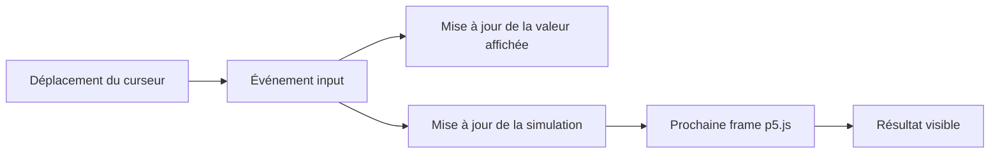
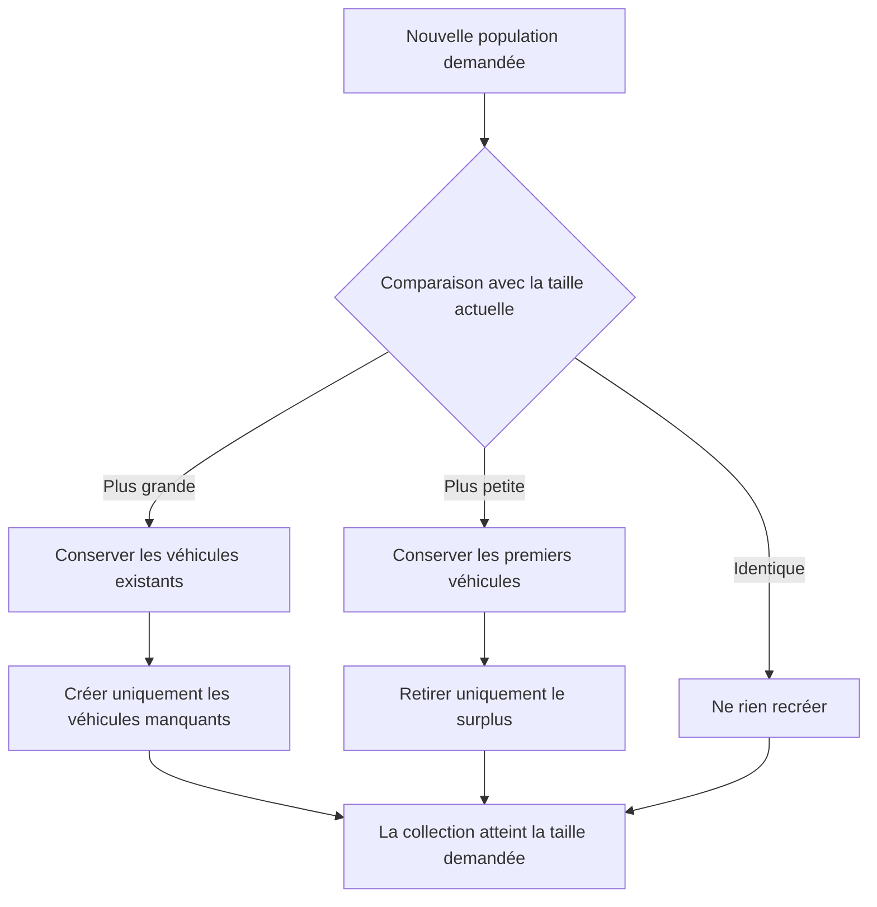
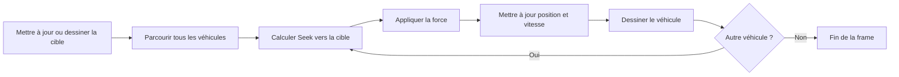
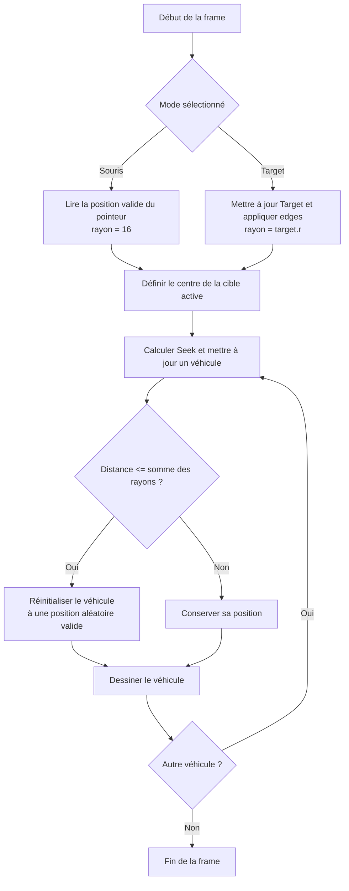
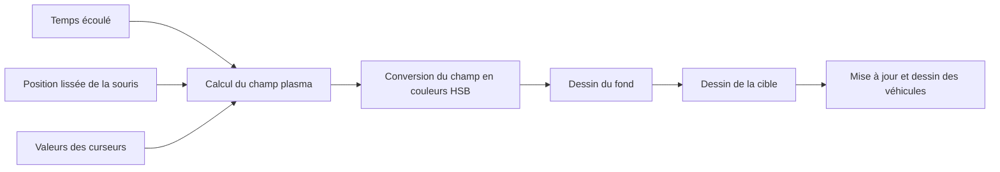
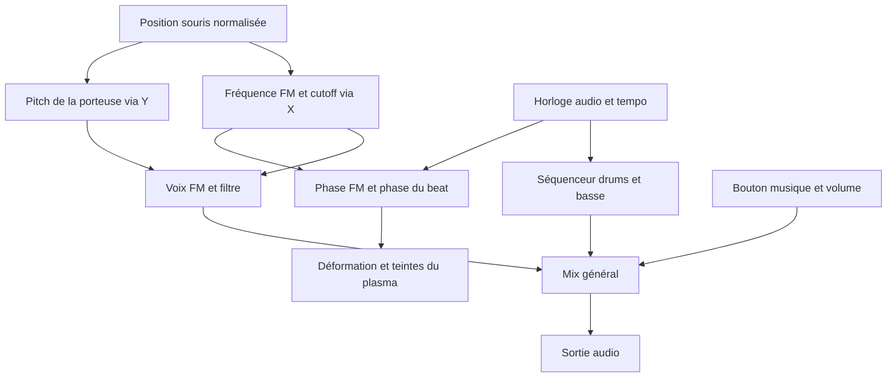

# Spécifications des évolutions de l'exemple `1-Seek`

Ce document décrit les évolutions prévues pour l'exemple `1-Seek`. Il constitue le contrat fonctionnel et technique à respecter avant toute implémentation.

## Tâche 1 [DONE] — Population de véhicules et réglage du mouvement

### Objectif pédagogique

L'exemple doit montrer que le comportement **Seek** peut être appliqué simultanément à plusieurs agents autonomes. L'utilisateur doit pouvoir observer immédiatement l'effet de trois paramètres :

- le nombre de véhicules présents dans la simulation ;
- leur vitesse maximale ;
- leur force de pilotage maximale.

Tous les agents restent des instances directes de la classe `Vehicle` et recherchent la même cible. La classe et le fichier `vehicle.js` ne doivent pas être modifiés pour cette tâche.

### Interface attendue

Une zone de contrôle visible doit proposer trois curseurs accompagnés chacun :

- d'un libellé explicite ;
- de la valeur courante affichée sous forme numérique ;
- de bornes et d'un pas cohérents avec le paramètre.

| Curseur | Minimum | Maximum | Pas | Valeur initiale proposée |
|---|---:|---:|---:|---:|
| Nombre de véhicules | 1 | 200 | 1 | 20 |
| Vitesse maximale | 0 | 40 | 0,1 | 4 |
| Force maximale | 0 | 10 | 0,01 | 0,1 |

Les valeurs initiales de vitesse et de force reprennent les valeurs par défaut actuelles de `Vehicle`. La population initiale de 20 véhicules rend l'effet collectif visible sans surcharger l'écran.

Les contrôles doivent rester utilisables à la souris, au toucher et au clavier. La manipulation d'un curseur ne doit pas déplacer involontairement la cible dans le canvas.

### Mise à jour en temps réel

Les curseurs doivent réagir à l'événement `input`. L'événement `change`, qui intervient généralement après le relâchement du curseur, ne répond pas au besoin.

À chaque valeur intermédiaire pendant le déplacement d'un curseur :

1. la valeur numérique affichée est actualisée ;
2. l'état de la simulation est mis à jour ;
3. le résultat devient visible au plus tard lors de la prochaine image dessinée par p5.js.



### Gestion du nombre de véhicules

La simulation possède une collection explicite de véhicules. Sa taille doit toujours correspondre à la valeur entière du curseur de population.

Lorsque le nombre demandé augmente :

- les véhicules existants sont conservés avec leur position, leur vitesse et leur accélération ;
- seules les instances manquantes sont créées ;
- chaque nouveau véhicule apparaît à une position aléatoire valide dans le canvas ;
- chaque nouveau véhicule reçoit les valeurs courantes de vitesse maximale et de force maximale.

Lorsque le nombre demandé diminue :

- seuls les véhicules en surplus sont retirés ;
- les instances conservées ne sont ni réinitialisées ni recréées.

La valeur affichée à côté du curseur et le nombre d'instances présentes doivent rester identiques, y compris pendant un déplacement rapide du curseur.



### Réglage de la vitesse maximale

Le curseur de vitesse modifie immédiatement la propriété `maxSpeed` de toutes les instances existantes.

Si la nouvelle limite est inférieure à la vitesse actuelle d'un véhicule, son vecteur vitesse doit être limité immédiatement à cette nouvelle valeur. Cela évite qu'il conserve temporairement une vitesse devenue interdite.

Une vitesse maximale égale à zéro immobilise les véhicules. Une augmentation ultérieure leur permet de reprendre leur recherche de la cible.

### Réglage de la force maximale

Le curseur de force modifie immédiatement la propriété `maxForce` de toutes les instances existantes. La nouvelle limite s'applique dès le calcul de pilotage suivant.

Une force maximale égale à zéro empêche la création d'une nouvelle correction de trajectoire. Un véhicule déjà en mouvement peut donc continuer sur son élan tant que sa vitesse maximale n'est pas elle aussi égale à zéro.

### Cycle d'une image

Tous les véhicules recherchent la même cible et suivent le même cycle à chaque appel de `draw()` :



### Organisation technique prévue

- `sketch.js` orchestre la cible, la collection de véhicules, les contrôles et la boucle de rendu.
- `vehicle.js` reste inchangé conformément aux règles d'architecture du projet.
- `index.html` et `style.css` peuvent être adaptés pour accueillir une zone de contrôle lisible.
- Si la logique de gestion de population devient assez importante pour être testée séparément, elle doit être placée dans un module dédié plutôt que dans `vehicle.js`.
- Les tests unitaires de cette tâche doivent être rangés avec les tests de l'exemple selon la convention retenue pour le projet.

### Critères d'acceptation

La tâche sera considérée comme terminée si toutes les conditions suivantes sont satisfaites :

1. La scène contient entre 1 et 200 instances de `Vehicle`.
2. Le curseur de population ajoute ou retire des véhicules pendant son déplacement, sans attendre son relâchement.
3. La valeur numérique affichée correspond toujours au nombre réel de véhicules.
4. Une augmentation de population conserve tous les véhicules déjà présents.
5. Une diminution conserve les véhicules restants sans réinitialiser leur état.
6. Tous les véhicules recherchent la même cible avec le comportement Seek existant.
7. Les curseurs de vitesse et de force mettent à jour toutes les instances pendant leur déplacement.
8. Les nouveaux véhicules héritent des limites de vitesse et de force actuellement sélectionnées.
9. Une baisse de vitesse maximale limite immédiatement les vitesses qui dépassent la nouvelle valeur.
10. Les trois contrôles sont utilisables à la souris, au toucher et au clavier.
11. L'utilisation des contrôles ne provoque pas de déplacement involontaire de la cible.
12. `vehicle.js` n'a subi aucune modification.
13. Tous les tests automatisés liés à la tâche passent avant de proposer un test manuel.

### Tests à prévoir lors de l'implémentation

Les tests unitaires devront au minimum vérifier :

- la création de la population initiale ;
- le respect des bornes 1 et 200 ;
- l'ajout du nombre exact d'instances ;
- le retrait du nombre exact d'instances ;
- la conservation des références et de l'état des véhicules non retirés ;
- l'application de `maxSpeed` et `maxForce` à tous les véhicules existants ;
- l'héritage de ces deux valeurs par un nouveau véhicule ;
- la limitation immédiate d'une vitesse supérieure à la nouvelle valeur maximale ;
- le comportement des valeurs nulles de vitesse et de force ;
- la conversion sûre de la valeur textuelle d'un curseur en nombre.

Un test d'intégration dans un navigateur devra aussi confirmer que plusieurs valeurs intermédiaires sont visibles pendant le déplacement continu de chaque curseur, avant son relâchement.

### Hors périmètre de la tâche 1

Cette tâche n'ajoute pas de nouveau steering behavior, de collision entre véhicules, de comportement de groupe, de retour aux bords, de réapparition ni de nouvelle classe d'entité. Ces évolutions pourront faire l'objet de tâches séparées.

## Tâche 2 [DONE] — Choix de la cible et réapparition des véhicules

### Objectif pédagogique

Cette tâche permet de comparer le même comportement Seek face à deux types de cibles : une cible directement pilotée par la souris et une cible autonome représentée par une instance de la classe `Target`.

Lorsqu'un véhicule atteint la cible active, il doit réapparaître immédiatement à une position aléatoire dans le canvas. La détection doit tenir compte de la taille visible de la cible et de celle du véhicule.

Cette tâche dépend de la collection de véhicules définie dans la tâche 1. Elle ne nécessite aucune modification de `vehicle.js`.

### Menu de sélection du mode

La zone de contrôle doit comporter un menu intitulé **Cible** proposant exactement les deux options suivantes :

1. **Suivre la souris** ;
2. **Suivre une cible autonome**.

Le mode initial proposé est **Suivre la souris**, afin de conserver le comportement actuel de l'exemple.

Le changement de mode doit prendre effet dès la sélection d'une option. Tous les véhicules doivent toujours suivre la même cible active. Le mode choisi doit être identifiable à la fois par la valeur du menu et par la cible dessinée dans le canvas.

### Mode « Suivre la souris »

- Le centre de la cible correspond à la position de la souris dans le canvas.
- La cible conserve son apparence actuelle : un cercle de 32 px de diamètre, soit un rayon de 16 px.
- La position ne doit être mise à jour que lorsque le pointeur se trouve dans le canvas. La manipulation du menu ou des curseurs ne doit donc pas déplacer la cible.
- Tous les véhicules utilisent le vecteur correspondant au centre de ce cercle pour calculer Seek.

### Mode « Suivre une cible autonome »

- La cible active est une véritable instance de la classe `Target` définie dans `target.js`.
- Une seule instance persistante doit être créée et réutilisée lors des changements de mode. Il ne faut pas recréer une cible à chaque frame ni à chaque retour dans ce mode, car son constructeur installe un temporisateur.
- Lorsque ce mode est actif, la cible est mise à jour, maintenue dans le canvas avec la méthode `edges()`, puis dessinée à chaque frame avec ses méthodes publiques.
- Les véhicules utilisent `target.pos` comme destination du comportement Seek.
- Le rayon courant `target.r` doit être lu à chaque frame, car la classe `Target` peut le faire varier au cours de la simulation.
- Lorsque ce mode est inactif, sa position ne doit pas être mise à jour et la cible ne doit pas être dessinée. Le temporisateur déjà créé par `Target` peut néanmoins continuer à modifier ses paramètres internes, comme le rayon, la couleur ou le vecteur vitesse. Au retour dans ce mode, la même instance reprend donc depuis sa dernière position avec l'état interne alors courant.

### Détection de l'arrivée sur la cible

La cible et chaque véhicule sont considérés comme des disques pour la détection. Un véhicule atteint la cible lorsque la distance entre leurs centres est inférieure ou égale à la somme de leurs rayons :

```text
distance(centre du véhicule, centre de la cible) <= rayon du véhicule + rayon de la cible
```

Les rayons à utiliser sont :

| Élément | Rayon de collision |
|---|---:|
| Véhicule | `vehicle.r` |
| Cible souris | 16 px |
| Instance de `Target` | valeur courante de `target.r` |

La collision doit être testée séparément pour chaque véhicule, après la mise à jour de sa position durant la frame. Ainsi, le test porte sur la position qui sera effectivement affichée.



### Réapparition d'un véhicule

Lorsqu'une collision est détectée :

- la même instance de `Vehicle` est conservée ;
- sa position est remplacée par une position aléatoire entièrement comprise dans le canvas ;
- la nouvelle position doit se trouver hors de la zone de collision de la cible active, afin d'éviter plusieurs réapparitions successives ;
- sa vitesse et son accélération sont remises à zéro pour commencer une nouvelle poursuite de façon prévisible ;
- ses valeurs courantes `maxSpeed` et `maxForce` sont conservées ;
- le nombre total de véhicules reste inchangé.

La position aléatoire doit tenir compte de `vehicle.r` afin que le véhicule soit entièrement visible lors de sa réapparition. Si aucune position valide n'est trouvée après un nombre limité de tentatives, une stratégie de repli déterministe doit choisir le point valide le plus éloigné de la cible. Cette précaution évite une boucle infinie sur un canvas exceptionnellement petit.

### Organisation technique prévue

- `sketch.js` sélectionne la cible active, orchestre sa mise à jour et parcourt les véhicules.
- `target.js` et `vehicle.js` restent inchangés.
- Les calculs de collision et de position de réapparition doivent être isolés dans des fonctions testables, ou dans un module dédié si cela rend le code plus clair.
- Le menu doit être placé avec les trois contrôles de la tâche 1 et recevoir un libellé HTML associé.
- Le code consommateur doit convertir les deux modes en une représentation commune contenant au minimum un centre et un rayon. Cela évite de dupliquer la boucle de traitement des véhicules.

### Critères d'acceptation

La tâche 2 sera considérée comme terminée si toutes les conditions suivantes sont satisfaites :

1. Le menu propose les modes **Suivre la souris** et **Suivre une cible autonome**.
2. Le changement de mode est visible immédiatement et s'applique à tous les véhicules.
3. Le mode souris conserve une cible circulaire de 32 px de diamètre.
4. Le mode autonome utilise une instance réelle et unique de `Target`.
5. La position de la cible autonome est mise à jour, contrainte par `edges()` et dessinée uniquement lorsque son mode est actif.
6. La collision tient compte de `vehicle.r` et du rayon courant de la cible active.
7. Chaque véhicule qui atteint la cible réapparaît à une position aléatoire valide, hors de la cible.
8. Une réapparition conserve l'instance, `maxSpeed`, `maxForce` et le nombre total de véhicules.
9. La vitesse et l'accélération du véhicule réapparu sont nulles.
10. La manipulation du menu et des curseurs ne déplace pas la cible souris.
11. Les fichiers `vehicle.js` et `target.js` n'ont subi aucune modification.
12. Tous les tests automatisés liés aux tâches 1 et 2 passent avant de proposer un test manuel.

### Tests à prévoir lors de l'implémentation

Les tests unitaires devront au minimum vérifier :

- le rayon fixe de 16 px de la cible souris ;
- l'utilisation du rayon courant d'une instance de `Target` ;
- une collision lorsque la distance est inférieure à la somme des rayons ;
- une collision lorsque la distance est exactement égale à la somme des rayons ;
- l'absence de collision juste au-delà de cette limite ;
- la conservation de l'identité du véhicule après sa réapparition ;
- la validité de la nouvelle position par rapport aux limites du canvas ;
- l'absence de collision immédiate à la nouvelle position ;
- la remise à zéro de la vitesse et de l'accélération ;
- la conservation de `maxSpeed` et `maxForce` ;
- la stabilité du nombre de véhicules ;
- la création d'une seule instance de `Target` malgré plusieurs changements de mode ;
- le fonctionnement de la stratégie de repli sur un canvas trop petit pour un tirage aléatoire normal.

Un test d'intégration dans un navigateur devra confirmer que le menu change effectivement la cible suivie, que les véhicules réapparaissent dans les deux modes et que la taille variable de l'instance de `Target` modifie bien la zone de collision visible.

## Tâche 3 [DONE] — Fond psychédélique interactif

### Objectif visuel

Le fond noir doit être remplacé par une animation psychédélique de type plasma. Elle doit produire des formes organiques comparables à des blobs colorés qui se déplacent, se déforment et se mélangent continuellement dans les couleurs de l'arc-en-ciel.

Le plasma reste un élément d'arrière-plan : la cible, les véhicules et leurs éventuels indicateurs doivent être dessinés par-dessus et rester lisibles. Cette tâche ne modifie ni le comportement Seek ni les classes `Vehicle` et `Target`.

### Principe de l'animation

Le plasma doit être calculé à partir de plusieurs composantes périodiques animées, par exemple des ondes sinusoïdales et des champs radiaux mobiles. Leur combinaison produit une valeur continue pour chaque point du fond. Cette valeur est convertie en teinte dans l'espace colorimétrique HSB afin de parcourir tout le cercle chromatique.

L'animation doit :

- évoluer continuellement en fonction du temps ;
- utiliser le temps écoulé et non le seul numéro de frame, afin de conserver une vitesse comparable lorsque le nombre d'images par seconde varie ;
- produire des transitions continues sans changement brutal de couleur ;
- couvrir tout le canvas, y compris après un redimensionnement de la fenêtre ;
- être dessinée avant la cible et les véhicules à chaque frame.



### Interaction avec la souris

La position de la souris dans le canvas doit influencer visiblement le plasma sans remplacer son animation autonome :

- la coordonnée horizontale fait varier la phase horizontale et décale localement les teintes ;
- la coordonnée verticale fait varier la phase verticale et la déformation des blobs ;
- un champ radial centré sur le pointeur déforme localement le motif ;
- les coordonnées utilisées sont normalisées par rapport à la largeur et à la hauteur du canvas afin de produire un effet cohérent sur toutes les tailles d'écran ;
- la position qui pilote l'effet est lissée dans le temps pour éviter les secousses lorsque le pointeur se déplace rapidement.

La position interactive ne doit être actualisée que lorsque le pointeur se trouve dans le canvas. Quand il en sort, la dernière position valide est conservée. Avant le premier mouvement, le centre du canvas sert de position initiale.

La même position de pointeur peut alimenter le plasma et la cible souris de la tâche 2, mais ces deux usages restent indépendants. Manipuler les contrôles de l'interface ne doit déplacer ni la cible souris ni le centre d'influence du plasma.

### Contrôles du plasma

Les contrôles suivants doivent être ajoutés à la zone d'interface existante. Leur valeur numérique courante doit être affichée et mise à jour avec l'événement `input`.

| Curseur | Minimum | Maximum | Pas | Valeur initiale proposée | Effet |
|---|---:|---:|---:|---:|---|
| Vitesse du plasma | 0 | 3 | 0,05 | 1 | Multiplie la vitesse d'évolution temporelle |
| Complexité | 1 | 8 | 1 | 4 | Fixe le nombre de composantes ou de blobs combinés |
| Taille des blobs | 40 | 400 | 10 | 160 | Règle l'échelle spatiale des formes |
| Teinte | 0 | 360 | 1 | 0 | Effectue une rotation globale dans le cercle chromatique |
| Saturation | 40 | 100 | 1 | 90 | Règle l'intensité des couleurs sans supprimer totalement l'effet arc-en-ciel |
| Influence de la souris | 0 | 2 | 0,05 | 1 | Règle l'intensité de la déformation locale produite par le pointeur |

Une vitesse nulle fige l'évolution liée au temps. Le plasma doit toutefois encore pouvoir réagir à un déplacement de la souris ou à la modification d'un autre paramètre. Une influence de souris nulle supprime uniquement la déformation interactive et conserve l'animation autonome.

La complexité est une valeur entière. Une modification de ce curseur doit conserver les composantes déjà actives et seulement ajouter ou ignorer les composantes nécessaires, afin d'éviter un changement aléatoire complet du motif.

### Rendu et performances

Le calcul du plasma ne doit pas compromettre la fluidité de la simulation avec 200 véhicules. L'implémentation recommandée utilise une surface graphique hors écran de résolution réduite, avec une densité de pixels égale à 1, ensuite agrandie sur le canvas avec interpolation.

La résolution interne constitue un détail de rendu et ne doit pas être exposée comme paramètre pédagogique. Elle doit être choisie ou adaptée pour viser une animation fluide sur une machine courante tout en évitant une pixellisation gênante.

Les règles suivantes s'appliquent :

- une seule surface hors écran est conservée entre les frames ;
- elle n'est recréée que lors de l'initialisation ou d'un redimensionnement utile ;
- aucun tableau, objet graphique ou composant permanent ne doit être recréé pour chaque pixel et chaque frame ;
- les phases et positions initiales des composantes sont générées une seule fois puis réutilisées ;
- le calcul doit être séparé de l'affichage afin de pouvoir tester les transformations de paramètres sans dépendre du canvas ;
- les styles graphiques du plasma ne doivent pas modifier ceux utilisés ensuite pour la cible ou les véhicules.

Si les performances mesurées restent insuffisantes, une surface hors écran WebGL et un shader peuvent constituer une évolution ultérieure. La première implémentation doit privilégier une version 2D lisible pour les étudiants.

### Lisibilité de la simulation

Le fond doit rester lumineux et coloré, sans masquer les éléments pédagogiques. Les véhicules et les cibles doivent conserver un contraste suffisant sur toutes les teintes. Ce contraste peut être obtenu dans `sketch.js` par une légère ombre ou une couche translucide locale, sans modifier `vehicle.js` ni `target.js`.

Les contrôles HTML doivent rester dans une zone stable et lisible qui ne reçoit pas les couleurs animées du plasma. Le redimensionnement du canvas ne doit ni recouvrir cette interface ni fausser les coordonnées de la souris.

### Organisation technique prévue

- `sketch.js` orchestre l'ordre de rendu et transmet au plasma le temps, la position du pointeur et les paramètres courants.
- Le calcul du plasma doit être placé dans un fichier séparé, par exemple `plasma.js`, afin de ne pas surcharger la boucle principale et de faciliter les tests.
- `index.html` charge ce nouveau fichier et accueille les contrôles supplémentaires.
- `style.css` organise les contrôles sans placer de logique de simulation dans l'interface.
- `vehicle.js` et `target.js` restent inchangés.

### Critères d'acceptation

La tâche 3 sera considérée comme terminée si toutes les conditions suivantes sont satisfaites :

1. Le fond du canvas affiche un plasma animé couvrant toute la surface disponible.
2. Le motif comporte des blobs mobiles et des couleurs parcourant visiblement l'arc-en-ciel.
3. La position de la souris dans le canvas influence le motif de manière visible et lissée.
4. L'utilisation des contrôles ne modifie pas la position interactive conservée dans le canvas.
5. Les six curseurs modifient leur paramètre pendant leur déplacement, avant leur relâchement.
6. La valeur affichée pour chaque curseur correspond toujours au paramètre réellement utilisé.
7. Une vitesse nulle fige le temps du plasma sans désactiver ses autres interactions.
8. Une influence de souris nulle conserve une animation autonome.
9. La cible et les véhicules restent visibles sur l'ensemble de la palette.
10. Le plasma s'adapte correctement au redimensionnement du canvas.
11. La simulation reste utilisable avec 200 véhicules sur une machine courante.
12. Aucune surface graphique ni structure permanente n'est recréée inutilement à chaque frame.
13. Les fichiers `vehicle.js` et `target.js` n'ont subi aucune modification.
14. Tous les tests automatisés liés aux trois tâches passent avant de proposer un test manuel.

### Tests à prévoir lors de l'implémentation

Les tests unitaires devront au minimum vérifier :

- la conversion des valeurs textuelles des six curseurs en nombres valides ;
- le bornage de chaque paramètre ;
- le caractère entier de la complexité ;
- la normalisation des coordonnées de la souris entre 0 et 1 ;
- la conservation de la dernière position valide lorsque le pointeur quitte le canvas ;
- l'initialisation de cette position au centre du canvas ;
- la progression temporelle proportionnelle à la vitesse sélectionnée ;
- l'absence de progression temporelle lorsque cette vitesse vaut zéro ;
- la désactivation de la seule déformation interactive lorsque l'influence vaut zéro ;
- la continuité et le bouclage des teintes entre 0 et 360 degrés ;
- la stabilité des composantes existantes lors d'un changement de complexité ;
- la réutilisation de la surface hors écran entre deux frames ;
- sa recréation avec des dimensions valides après un redimensionnement.

Un test d'intégration dans un navigateur devra vérifier visuellement le mouvement des blobs, la réaction à la souris, l'effet perceptible de chaque curseur, le contraste des véhicules et la fluidité avec 1 puis 200 véhicules. La vérification de performance devra rapporter une mesure sur une durée fixe plutôt qu'une simple impression visuelle.

## Tâche 4 [DONE] — Musique interactive et plasma synchronisé

### Objectif

Créer une ambiance techno/électro entièrement synthétisée avec la Web Audio API native : une voix FM interactive, des drums synthétiques et une basse mélodique séquencée. La souris pilote le timbre et la hauteur de la voix FM. Le plasma doit réagir à la même modulation, avec une phase commune au son et à l'image.

Cette tâche est implémentée dans `interactive-audio.js`, avec intégration dans `sketch.js` et `plasma.js`. Les tâches 1, 2 et 3 restent acquises. `vehicle.js` et `target.js` restent inchangés.

### Commandes et activation

- Le panneau de contrôles est masqué au chargement. Un bouton **UI on/off**, toujours accessible en bas à droite, affiche ou masque le panneau sans changer l'état de la musique. Le panneau masqué ne capture plus les mouvements de souris.
- Toutes les 10 secondes de musique, un profil sonore aléatoire renouvelle les timbres et les notes de basse dans une gamme pentatonique mineure. Les paramètres continus passent au nouveau profil sur trois secondes. Les notes changent sur les pas du séquenceur, et les commandes X/Y restent prioritaires pour la fréquence FM, le cutoff et la hauteur.

- Un bouton **Activer la musique / Couper la musique** commande l'ensemble du mix : voix FM, basse, kick, snare et clap.
- La musique est désactivée au chargement. Le contexte audio est créé ou repris depuis une interaction explicite avec le bouton.
- Un curseur de volume général, initialisé à 25 %, permet de régler le niveau de sortie.
- Un curseur de tempo, proposé entre 80 et 160 BPM avec une valeur initiale de 124 BPM, règle conjointement les drums et la basse.
- L'état du bouton et son attribut `aria-pressed` doivent toujours correspondre à l'état réel de la musique.

La coupure doit rendre **tout le mix silencieux**, avec une courte rampe de gain de 20 à 50 ms pour éviter les clics. Elle arrête la planification et les sources, annule les événements futurs et suspend le contexte après extinction du son. Elle ne doit pas simplement désactiver la FM ou la synchronisation visuelle.

La réactivation redémarre proprement la séquence au début d'une mesure. Les activations répétées ne doivent créer ni séquenceur concurrent ni accumulation de sources ou de contextes audio.

### Interaction avec la souris

Les coordonnées sont normalisées dans le repère du canvas : `u = x / width` et `v = y / height`, bornées entre 0 et 1. Seuls les mouvements dans le canvas actualisent ces valeurs. Manipuler le panneau conserve la dernière position valide. Le centre sert de position initiale.

| Contrôle | Bord gauche / haut | Bord droit / bas | Conversion proposée |
|---|---|---|---|
| X : fréquence de modulation FM | 1 Hz à gauche | 20 Hz à droite | `1 + 19 × u` |
| X : cutoff du filtre passe-bas | 120 Hz à gauche | 12 000 Hz à droite | `120 × 100^u`, bornée selon la fréquence d'échantillonnage |
| Y : fréquence porteuse | 880 Hz en haut | 55 Hz en bas | `55 × 2^(4 × (1 − v))`, soit quatre octaves |

Le filtre passe-bas s'applique à la voix FM et à la basse : à gauche, leur son est étouffé et dominé par les basses ; à droite, leurs harmoniques deviennent audibles. Les drums conservent leur articulation sur un bus distinct. Cette répartition permet d'entendre clairement l'effet du cutoff sans perdre le beat.

Les changements de fréquence, de profondeur et de cutoff sont lissés par des automatisations audio courtes. Les valeurs appliquées à l'audio et transmises au plasma doivent suivre la même trajectoire temporelle. La position Y transpose la voix FM en continu ; la basse conserve ses notes séquencées pour maintenir une assise musicale stable.

### Voix FM

Une porteuse sinusoïdale reçoit une modulation de fréquence sinusoïdale. Le modulateur, entre 1 et 20 Hz, agit sur la fréquence de la porteuse et doit être audible comme une variation de hauteur ou une texture rythmique. Il ne remplace pas le signal sonore par une simple modulation de volume.

La profondeur proposée est de 15 % de la fréquence porteuse : elle évolue avec le pitch tout en conservant une fréquence instantanée positive. Le gain de la voix est équilibré avec les autres instruments. Une enveloppe d'activation et d'extinction évite les départs et arrêts brutaux.

### Drums et basse séquencée

Une mesure comporte quatre temps, divisés en seize pas. Le séquenceur utilise l'horloge audio et programme les événements légèrement à l'avance. `draw()` ne doit pas déclencher les notes : une baisse du framerate ne doit pas désorganiser la musique.

Arrangement initial proposé, avec des pas numérotés de 1 à 16 :

| Instrument | Pas actifs | Synthèse |
|---|---|---|
| Kick | 1, 5, 9, 13 | Sinusoïde avec chute rapide de fréquence et enveloppe courte |
| Snare | 5, 13 | Bruit filtré mêlé à une composante tonale courte |
| Clap | 5, 13 | Plusieurs impulsions rapprochées de bruit filtré, puis une courte traîne |
| Basse | 1, 3, 4, 7, 9, 11, 12, 15 | Oscillateur riche en harmoniques, enveloppe courte et filtrage |

La basse joue une boucle de deux mesures en la mineur. Exemple proposé : première mesure `A1, A1, E2, G1, A1, C2, E2, G1`, seconde mesure `F1, F1, C2, E1, G1, G1, D2, E2`. Chaque note correspond à un pas actif de basse dans l'ordre indiqué. Les durées et accents doivent donner un groove électro, avec un espace audible entre les notes.

Tous les instruments sont synthétiques : aucun fichier musical externe n'est nécessaire. Le bruit est préparé dans un tampon réutilisable ; les sources ponctuelles sont déconnectées après leur fin. Un gain général et une dynamique maîtrisée évitent la saturation lors de la superposition du kick, de la snare, du clap et de la basse.

### Synchronisation du plasma

Le modulateur audio et le plasma partagent une fréquence et une phase calculées depuis `AudioContext.currentTime`. La phase doit être intégrée de manière continue lors des variations de X ; multiplier simplement la nouvelle fréquence par le temps absolu provoquerait des sauts.

La phase de modulation pilote une déformation locale des blobs et une rotation des teintes. Le beat ajoute une impulsion douce sur la taille ou le déplacement des formes, particulièrement sur les kicks. Les couleurs restent continues et lumineuses ; la synchronisation évite les extinctions complètes et les alternances de luminosité brutales.

Les six curseurs de plasma restent utilisables : ils règlent le motif de base et l'amplitude du mouvement, tandis que l'horloge audio fournit la phase synchronisée. Avec une vitesse de plasma nulle, la progression autonome est figée, mais les interactions souris et musicales restent possibles.

Lorsque la musique est coupée, le plasma revient progressivement à son animation autonome de la tâche 3. Le bouton audio ne doit jamais figer l'ensemble de l'animation.



### Organisation et tests

Un fichier dédié, par exemple `interactive-audio.js`, contient le graphe audio, le séquenceur, les instruments et leur cycle de vie. Des fonctions pures exposent les conversions de coordonnées, les notes et les phases pour les tests. `sketch.js` orchestre les entrées et le rendu, et `plasma.js` reçoit l'état de synchronisation sans créer de nœuds audio.

Les tests unitaires doivent couvrir :

- les extrémités exactes et le bornage des conversions FM, cutoff et pitch ;
- les quatre octaves et le sens grave en bas / aigu en haut ;
- les événements de la séquence et leur placement temporel aux tempos limites ;
- la continuité de phase lors des changements de fréquence ;
- l'arrêt du séquenceur et l'absence de duplication après plusieurs cycles on/off ;
- l'extinction et le nettoyage de toutes les sources, y compris les notes déjà programmées ;
- le retour du plasma à son animation autonome après l'arrêt audio.

Une validation navigateur complète les tests unitaires : activation après clic, perception des variations X/Y, effet audible du filtre, beat régulier malgré la charge graphique et synchronisation visuelle. Le silence après coupure doit être mesuré sur le mix final avec un analyseur ou un rendu audio hors ligne, après la rampe et la fin de nettoyage ; le seul changement de libellé du bouton ne constitue pas une preuve.

### Critères d'acceptation

1. Aucun son n'est joué avant l'activation explicite.
2. X couvre bien 1 à 20 Hz de modulation FM et ouvre progressivement le filtre.
3. Y couvre plusieurs octaves avec les graves en bas et les aigus en haut.
4. Kick, snare, clap et basse sont synthétiques et partagent un beat régulier.
5. La basse joue une boucle mélodique techno/électro identifiable.
6. Le plasma suit la phase FM et le beat sans saut lors des mouvements de souris.
7. Le bouton coupe ou active réellement tous les instruments.
8. Plusieurs cycles on/off ne multiplient pas les sources ou les séquenceurs.
9. L'animation autonome reste active lorsque la musique est coupée.
10. Les véhicules et les contrôles des tâches précédentes restent fonctionnels.
11. Tous les tests pertinents passent avant de proposer un essai utilisateur.

## Tâche 5 [DONE] — Fuite de la cible devant les vaisseaux

Ajouter un troisième mode de comportement dans le menu de sélection de la cible :

- **Suivre la souris** (comportement existant) ;
- **Suivre une cible autonome** (comportement existant) ;
- **La cible fuit les vaisseaux** (nouveau comportement).

Le troisième mode réutilise l’unique instance persistante de `TargetFuyante`, sous-
classe de `Target` définie dans `targetFuyante.js`. La cible est normalement autonome ;
lorsqu’un vaisseau devient une menace, elle passe dans un état de fuite temporaire.

### Détection et sélection de la menace

- Ajouter un curseur **Rayon de détection** (en pixels), avec une valeur par défaut de
  `200`, une plage proposée de `50` à `500` et un pas de `10`.
- À chaque frame, calculer la distance entre le centre de la cible et chaque véhicule.
  Un véhicule est détecté lorsque cette distance est inférieure ou égale au rayon.
- Si plusieurs véhicules sont détectés, retenir le plus proche comme menace courante.
  Cette règle rend le comportement déterministe et correspond à l’API `flee()` qui
  reçoit une position cible.
- La détection est effectuée avant la mise à jour du déplacement de la cible. Le
  calcul doit tenir compte de la position réellement utilisée par le véhicule et la
  cible, sans modifier les classes protégées `vehicle.js` et `target.js`.

### États et comportement de fuite

Le comportement est une petite machine à états : `normal`, `fleeing` et
`exhausted/cooldown`.

- En état `normal`, la cible conserve son comportement autonome habituel.
- Lorsqu’une menace entre dans le rayon, la cible démarre une fuite en utilisant le
  comportement `flee()` de `TargetFuyante`, spécialisation du steering behavior de
  `Vehicle`. La force appliquée doit l’éloigner du véhicule sélectionné.
- Ajouter un curseur **Distance de sortie** (par défaut `300` px, plage proposée
  `100`–`800` px, pas `10`). La fuite continue tant que la menace la plus proche reste
  à l’intérieur de cette distance. Pour éviter les basculements rapides, la valeur
  effective doit rester supérieure ou égale au rayon de détection.
- La fuite s’arrête lorsque la distance atteint ou dépasse la distance de sortie.
  La cible reprend alors ses limites normales de vitesse et de force.
- Si la cible épuise son endurance avant de sortir du rayon, elle passe en
  `exhausted/cooldown` et reprend ses paramètres normaux. Elle ne doit pas redémarrer
  immédiatement tant que les véhicules n’ont pas quitté le rayon de détection, afin
  d’éviter une alternance frame par frame.
- Si une menace plus proche apparaît pendant une fuite, elle peut remplacer la menace
  courante, mais cela ne remet pas le chronomètre à zéro.
- La méthode `update()` et la méthode `edges()` de la cible restent appelées une seule
  fois par frame, comme dans les autres modes.

### Vitesse, force et fatigue

- Ajouter un curseur **Durée maximale de fuite** (en secondes), par défaut `2.0`, avec
  une plage proposée de `0.5` à `5.0` et un pas de `0.1`.
- Au début d’une fuite, mémoriser les valeurs normales de `maxSpeed` et `maxForce`,
  puis appliquer des valeurs renforcées (multiplicateurs constants documentés, par
  exemple `2×` pour chacune). Ces valeurs élevées ne sont actives que pendant la fuite.
- Le chronomètre démarre à l’entrée dans l’état `fleeing`. L’endurance est initialisée
  à `100 %` puis décroît linéairement jusqu’à `0 %` pendant la durée maximale.
- À la sortie de fuite ou lors de l’épuisement, restaurer exactement les valeurs
  précédentes de vitesse et de force.
- Afficher au-dessus de la cible une barre d’endurance visible **uniquement** dans
  l’état `fleeing`. Sa largeur doit suivre la taille de la cible, son remplissage doit
  représenter le pourcentage restant et sa couleur peut évoluer du vert vers le jaune
  puis le rouge. La barre doit rester lisible sur le plasma et ne doit pas être
  affichée dans les autres modes ou états.

### Interface utilisateur

- Dans le mode **La cible fuit les vaisseaux**, ajouter un curseur **Cibles fuyantes**
  (de `1` à `20`, valeur initiale `3`). Le curseur est masqué dans les modes souris
  et cible autonome et sa valeur est appliquée à chaque événement `input`.
- Ajouter un curseur **Temps avant duplication** (en secondes), par défaut `4.0`, avec
  une plage proposée de `1` à `10`. Chaque cible qui atteint cette durée de survie
  démarre une animation de scission de `0.7` seconde, puis donne naissance à deux
  cibles ; chacune recommence son propre chronomètre à zéro.
- Chaque instance créée est une `TargetFuyante` indépendante. Les véhicules suivent
  la cible fuyante la plus proche et chaque cible conserve son propre état de fuite,
  son endurance et son cooldown.
- Les trois curseurs doivent être mis à jour avec l’événement `input` afin que leur
  valeur numérique et le comportement changent en temps réel pendant le déplacement.
- Afficher les unités (`px` ou `s`) et les valeurs courantes à côté des curseurs.
- Le menu de mode applique le changement immédiatement avec l’événement `change`.
- Les contrôles restent intégrés au panneau existant, masqué par défaut par le bouton
  **UI on/off**.
- Ajouter un mode debug basculable avec la touche `d` ou la case **Mode debug** de
  l’interface. Lorsqu’il est actif, afficher le rayon de détection de la cible en mode
  fuite et les vecteurs rouges de vitesse des véhicules. Ces aides sont masquées dans
  tous les autres cas.

### Workflow

```mermaid
flowchart TD
  A[Mode "cible fuit les vaisseaux"] --> B[Mise à jour des curseurs]
  B --> C[Calculer les distances aux véhicules]
  C --> D{Véhicule dans le rayon de détection ?}
  D -- Non --> E[Comportement autonome normal]
  D -- Oui --> F[Sélectionner le véhicule le plus proche]
  F --> G{État normal et cible armée ?}
  G -- Oui --> H[Entrer en fuite, endurance = 100 %, limites renforcées]
  G -- Non --> I[Conserver la fuite et décrémenter le chronomètre]
  H --> J[Appliquer flee vers la menace]
  I --> J
  J --> K[update() puis edges() une seule fois]
  K --> L[Afficher la barre d'endurance]
  L --> M{Sortie atteinte ou durée maximale ?}
  M -- Non --> C
  M -- Oui --> N[Restaurer vitesse/force normales]
  N --> O{Véhicules encore dans le rayon ?}
  O -- Oui --> P[État exhausted/cooldown]
  O -- Non --> E
```

### Organisation proposée

`sketch.js` reste l’orchestrateur de la boucle et de l’interface. La cible mobile est
implémentée dans `targetFuyante.js` par la sous-classe `TargetFuyante extends Target`.
Elle porte la détection, la sélection de la menace, le steering `flee()`, le
chronomètre, l’endurance et les transitions. `target-utils.js` contient uniquement
les fonctions de scène pour le menu, les rayons de contact et les réapparitions. Cette
séparation évite de modifier `target.js` ou les exemples protégés de `vehicle.js` et
permet de tester la sous-classe sans transformer `sketch.js` en contrôleur de
locomotion.

### Critères d’acceptation

1. Le menu propose exactement les trois modes. Le mode fuite affiche le curseur de
   population et crée le nombre demandé d’instances indépendantes de `TargetFuyante`,
   sous-classe de `Target` et donc de `Vehicle`.
2. Les trois curseurs affichent leur valeur en direct et respectent leurs bornes.
3. Une cible commence à fuir au seuil exact du rayon de détection, dans la direction
   opposée au véhicule le plus proche.
4. Elle cesse de fuir au seuil exact de la distance de sortie, ou à l’expiration de la
   durée maximale, puis restaure ses paramètres normaux.
5. Une nouvelle menace ne réinitialise pas la durée déjà consommée et le cooldown
   empêche les redémarrages immédiats.
6. La barre d’endurance est visible seulement pendant la fuite et son remplissage
   décroît jusqu’à zéro.
7. Lorsqu’un vaisseau atteint une cible fuyante, cette instance est supprimée et le
   compteur visible est décrémenté. Une cible qui survit à la durée configurée se
   scinde visuellement en deux demi-cercles pendant `0.7` seconde, puis est remplacée
   par deux instances indépendantes dont les chronomètres sont remis à zéro.
   La mise à jour des scissions et la suppression après collision utilisent des états
   de scène définis dans leur fonction d’orchestration ; aucune variable locale ne doit
   être utilisée depuis une autre fonction de boucle.
8. Les comportements des modes souris et cible autonome restent inchangés, la cible
   fuyante utilise l’héritage `TargetFuyante → Target → Vehicle`, et aucune classe
   `vehicle.js` ou `target.js` existante n’est modifiée.
9. La touche `d` et la case de l’interface commandent le même mode debug ; le rayon et
   les vecteurs rouges ne sont visibles que lorsque ce mode est actif.

### Vérifications et tests à prévoir lors de l’implémentation

- Tests unitaires des bornes et de la normalisation des trois curseurs.
- Tests de distance aux seuils, de sélection du véhicule le plus proche et de direction
  du vecteur de fuite.
- Tests des transitions `normal → fleeing → normal` et `fleeing → cooldown`, de la
  durée maximale et de la restauration des limites de vitesse/force.
- Tests de la fonction de calcul de l’endurance et du remplissage de la barre.
- Test navigateur vérifiant les trois modes, la mise à jour `input` et l’absence de
  mise à jour double de la cible.
- Test navigateur du cycle complet : survie, animation de scission, passage d’une
  cible à deux, collision et décrément du compteur sans erreur JavaScript.

## Documents associés

- [Analyse pédagogique de l'exemple](ANALYSE.md)
- [Consignes pour les agents](../AGENTS.md)
- [Règles d'architecture](../ARCHITECTURE.md)
