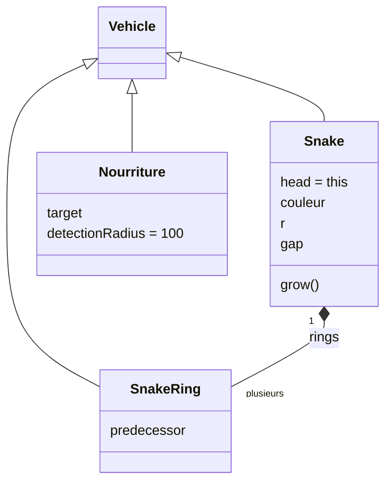
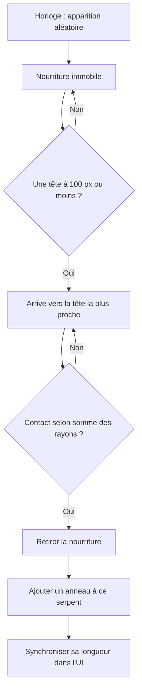

# Spécification — Serpents et nourriture dans 3-Arrival

**[DONE] Implémentation des serpents.**

**[DONE] Réglages individuels, espacement et stabilisation au repos.**

**[DONE] Nourriture SVG, attraction et croissance.**

Cette spécification remplace les choix initiaux de réglages globaux de taille et longueur. Le périmètre reste `3-Arrival`, conformément à `AGENTS.md` et `ARCHITECTURE.md`.

## 1. Architecture

`Snake extends Vehicle` représente la tête (`snake.head === snake`) et contient un tableau ordonné de `SnakeRing extends Vehicle`. Le premier anneau suit la tête, les suivants suivent leur prédécesseur. `Nourriture extends Vehicle` représente chaque nourriture, immobile jusqu'à sa détection d'une tête. Toutes les entités mobiles utilisent la locomotion héritée.

`vehicle.js` reste intact. Il contient déjà `Vehicle` et `Target` ; aucune classe de même nom n'est redéclarée. Les sous-classes réutilisent `super.arrive()`, `applyForce()` et `super.update()` lorsque leur contrat convient. Aucun prototype n'est modifié.

## 2. Suivi, arrêt et espacement

Le suivi est celui de la correction manuelle `3-Arrival_correction/snake.js` : la tête arrive vers la souris, chaque anneau vise le centre de son prédécesseur avec `arrive(predecessor.pos, distanceArret)`. La distance d'arrêt vaut `r_anneau + r_prédécesseur + gap`. Le curseur d'espacement désigne donc le vide entre les bords, 8 px par défaut, et non la distance entre centres.

Ne plus construire de point artificiel derrière l'orientation du prédécesseur. Une variation de direction ne doit pas déplacer la cible si le prédécesseur est immobile. L'orientation mémorisée reste utile au dessin et à l'initialisation, mais ne participe plus au suivi.

Mettre à jour la tête, puis chaque anneau de la tête vers la queue, comme dans la correction. Chaque anneau lit la nouvelle position du précédent et applique sa force avant sa propre intégration, une seule fois. Les vecteurs des voisins restent intacts.

Le steering attire si la distance est trop grande, freine à la distance d'arrêt et repousse si elle est trop petite. La vitesse désirée négative à distance inférieure au paramètre d'arrêt est ici intentionnelle. Réutiliser l'arrivée héritée lorsque la zone de freinage est supérieure à la distance d'arrêt ; traiter dans la sous-classe le cas inverse pour garder une pente positive et éviter les divisions par zéro.

La zone de repos porte sur l'erreur de distance, pas sur une position orientée : entrée à 0,6 px de l'espacement souhaité, reprise au-delà de 1,2 px. Appliquer `-velocity`, limité par `maxForce`, au repos. Ne jamais téléporter un anneau pour corriger l'espacement.

L'espacement reste un objectif de steering. Les virages et des réglages contrastés peuvent étirer ou replier la chaîne. Aucun redressement instantané après une trajectoire courbe ni séparation entre segments non consécutifs n'est imposé. Les petits déplacements ne doivent pas produire de grandes ondulations artificielles. Les anneaux ne rebouclent pas individuellement aux bords.

## 3. UI masquable et paramètres

Le panneau est masqué au démarrage ; le bouton permanent **UI on/off** reste accessible sur petit écran. Tous les curseurs utilisent `input` et montrent leur valeur en direct. Les interactions sur l'UI conservent la dernière cible du canvas. La touche D et la case debug sont synchronisées et ne perturbent pas la saisie dans les contrôles.

### Une carte par serpent

| Paramètre | Défaut | Plage |
| --- | --- | --- |
| Longueur en anneaux, sans la tête | 12 | 1 à 100 ; borne étendue après croissance. |
| Rayon de toute la chaîne | 12 px | 4 à 30 px. |
| Espace entre les bords | 8 px | 0 à 80 px. |
| Couleur de toute la chaîne | Palette différenciée | Sélecteur de couleur. |
| Vitesse max de la tête | 4 | 0 à 40. |
| Force max de la tête | 0,2 | 0 à 10. |

Les modifications s'appliquent uniquement au serpent de la carte, y compris à ses anneaux pour le rayon, la couleur et l'espacement. La longueur change à la queue, sans recréer la tête ou les anneaux conservés. Un repas actualise le curseur et sa valeur automatiquement. Les cartes ne sont reconstruites que lorsque la population de serpents change, sans perte des propriétés des instances conservées.

### Réglages communs

- Population : 1 à 20 serpents, 1 par défaut.
- Vitesse max des anneaux : 0 à 40, défaut 5.
- Force max des anneaux : 0 à 10, défaut 0,3.
- Freinage anneaux : 20 à 300 px, défaut 50.
- Freinage têtes : 20 à 300 px, défaut 100.
- Intervalle d'apparition de nourriture : 0,5 à 20 s, défaut 5 s.

Les réglages communs ne remplacent pas les choix individuels. Les nouveaux serpents utilisent les réglages communs actuels et les valeurs individuelles par défaut. Une vitesse maximale nulle immobilise ; une force maximale nulle supprime le steering mais peut laisser subsister une vitesse existante. Les unités de la base sont conservées : px/image et variation de vitesse/image pour une masse implicite de 1.

## 4. Nourriture et croissance

Créer cinq nourritures aléatoires au démarrage, puis une toutes les cinq secondes par défaut. Ne pas créer de timer dans `draw()` : utiliser une horloge basée sur le temps écoulé, injectable pour les tests. Un changement d'intervalle redémarre son délai. Une longue pause de l'onglet ne doit pas déclencher une rafale d'apparitions. Une limite de 100 nourritures simultanées évite une accumulation sans borne pendant les longues sessions.

Une nourriture démarre avec une vitesse nulle. Quand une tête entre dans son cercle de détection (`distance centres <= 100 px`), sélectionner la tête la plus proche à portée. La nourriture déclenche alors `arrive()` **vers cette tête**. Une fois l'attraction engagée, conserver cette cible même si elle s'éloigne. En cas de suppression du serpent, libérer la référence, freiner et permettre une nouvelle détection.

Le contact est testé avec les rayons réels : `distance <= r_nourriture + r_tête`. Retirer alors la nourriture de la scène et ajouter un anneau à ce serpent. Une nourriture ne peut nourrir qu'une seule tête, une seule fois, même en cas de superposition de plusieurs serpents. Les anneaux ne consomment pas de nourriture. La croissance dépasse si nécessaire la borne initiale de 100 du curseur.

## 5. Dessin et ressources

Tête et anneaux sont des cercles de diamètre `2 * r`, colorés par serpent. Les nourritures sont des SVG locaux : pomme, fraise, souris, fromage et carotte. Ils proviennent de [Twemoji v14.0.2](https://github.com/twitter/twemoji/tree/v14.0.2/assets/svg), Twitter et contributeurs, sous licence CC BY 4.0. Ils sont chargés dans `preload()`, avec attribution dans l'UI et dans `assets/food/ATTRIBUTION.md`, et copie du texte de licence.

Le debug affiche points de suivi, zones de freinage, vecteurs de vitesse et rayon de détection de la nourriture. Les rendus isolent leurs styles avec `push()` et `pop()`.

## 6. Fichiers et validation

`snake.js` : tête et chaîne ; `snakeRing.js` : suivi, arrêt et dessin ; `snake-controls.js` : UI ; `nourriture.js` : entité et horloge ; `sketch.js` : orchestration ; `assets/food/` : SVG et attribution ; `tests/snake.test.cjs` : tests des classes réelles avec adaptateur vectoriel.

Critères vérifiés :

1. Héritage Vehicle pour chaque entité, références des prédécesseurs, une intégration par image et absence de mutation des voisins.
2. Forces et vitesses bornées, absence de valeurs non finies, arrivée et conservation de l'espacement.
3. Stabilité d'une chaîne au repos après un virage et rejet des petites variations sous le seuil de reprise.
4. Paramètres individuels indépendants, réglages communs conservant les différences, identité maintenue lors des changements de population.
5. UI en direct, longueur mise à jour après un repas, panneau initialement masqué et utilisable sur petit écran.
6. Nourriture immobile hors portée, sélection de tête à la frontière de 100 px, attraction avec arrive, contact selon rayons, repas unique et croissance.
7. Abandon de référence à un serpent supprimé, horloge à cinq secondes et changement de fréquence.
8. Chargement et rendu des SVG avec le vrai p5.js, contrôles individuels et cycle de nourriture dans le navigateur.
9. Base `vehicle.js` non altérée par cette évolution.

Commande depuis la racine : `node --test 3-Arrival/tests/*.test.cjs`. Résultat : **24 tests réussis**, complétés par la validation Chrome.

Régression spécifique : petits déplacements alternés de quelques pixels, puis arrêt. Vérifier la stabilité des anneaux et l’absence d’amplification latérale, sur plusieurs espacements, avec les classes réelles et dans Chrome. Vérifier aussi que tourner la direction mémorisée d’un prédécesseur immobile ne déplace jamais la cible du suivant.
